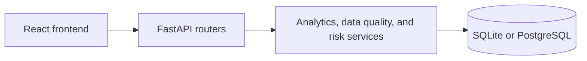

# SentinelEdu

SentinelEdu is a student-performance analytics application. Its active stack is a React and TypeScript frontend with a FastAPI, SQLAlchemy, and scikit-learn backend.

## What runs today

- JWT authentication with bcrypt password hashing and server-side roles: `admin`, `teacher`, and `student`.
- REST routers for authentication, classes, grades, attendance, risk assessment, analytics, and data-quality reporting.
- React routes for administrator, faculty, student, analytics, risk, and data-quality views.
- SQLite is the default test database. Tests use PostgreSQL when `TEST_DATABASE_URL` is set; CI configures a PostgreSQL service for that purpose.

## Engineering highlights

- JWT + bcrypt authentication with role-based access checks for admin, teacher, and student users.
- Structured audit logging and Prometheus HTTP and business metrics.
- A SQL analytics service using CTEs and window functions for performance summaries, declining-student analysis, and intervention ordering.
- Data-quality checks for missing records, invalid grade scores, future attendance, duplicates, enrollment consistency, empty classes, and referential integrity.
- A risk-scoring service that trains Logistic Regression and Decision Tree models on synthetic data. No accuracy claim is made.
- 44 backend tests at 75% coverage from the verified SQLite run.
- A CI workflow with a PostgreSQL service and a backend coverage test command.

## Lessons learned

Raw SQL compared an attendance enum to a lowercase literal. SQLite silently returned zero matches, while PostgreSQL raised an enum error. The queries now bind values built from the enum member, and analytics tests assert exact attendance and GPA values.

## Architecture

See [Architecture](docs/ARCHITECTURE.md), [Testing](docs/TESTING.md), and [Known limitations](docs/KNOWN_LIMITATIONS.md).

## Roadmap

No roadmap claims are made here; only implemented behavior is documented above.
