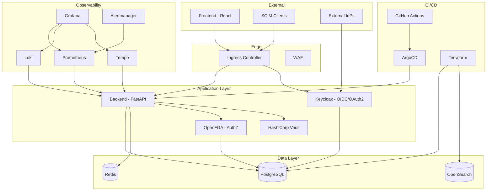

# SentinelEdu - Enterprise IAM & Student Analytics Platform

[](https://github.com/PIYUSHMISHRA1009/SentinelEdu/actions/workflows/ci.yml)
[](https://github.com/PIYUSHMISHRA1009/SentinelEdu/actions/workflows/security.yml)
[](https://opensource.org/licenses/MIT)
[](https://www.python.org/downloads/)
[](https://nodejs.org/)

> **Production-grade Enterprise Identity & Access Management (IAM) Platform** combined with **ML-powered Student Performance Analytics**. Built to demonstrate enterprise-grade architecture patterns aligned with Saviynt's IAM/IGA/ISPM domain.

## 🎯 Overview

**SentinelEdu** is a **production-grade Enterprise Identity & Access Management (IAM) platform** combined with **ML-powered Student Performance Analytics**. Built to demonstrate enterprise-grade architecture patterns aligned with Saviynt's IAM/IGA/ISPM domain.

### Key Capabilities

| Domain | Features |
|--------|----------|
| **🔐 Identity & Access** | JWT/OIDC auth, RBAC (Admin/Teacher/Student), SCIM 2.0 ready, Keycloak integration |
| **📊 Student Analytics** | Risk scoring (ML), GPA/attendance trends, real-time dashboards |
| **🤖 AI Security** | Isolation Forest anomaly detection, impossible travel, privilege escalation, brute force detection |
| **📈 Observability** | Full LGTM stack (Loki, Grafana, Tempo, Prometheus), structured audit logging |
| **☁️ Cloud-Native** | Multi-cloud Terraform (AWS/GCP), Helm + Kustomize, GitOps (ArgoCD) |
| **🔒 Security** | Vault secrets, mTLS-ready, network policies, structured audit logs |

---

## 🏗️ Architecture



---

## 🚀 Quick Start

### Prerequisites
- **Docker & Docker Compose** (v2.0+)
- **Python 3.11+** (for local backend development)
- **Node.js 18+** (for frontend development)
- **Make** (optional, for convenience commands)

### 1. Clone & Start Full Stack

```bash
git clone https://github.com/PIYUSHMISHRA1009/SentinelEdu.git
cd SentinelEdu

# Start all services (PostgreSQL, Redis, Loki, Prometheus, Grafana, Keycloak, OpenFGA, OpenSearch, MLflow, Backend, Frontend)
docker-compose up -d
```

### 2. Verify Services

| Service | URL | Credentials |
|---------|-----|-------------|
| **Backend API** | http://localhost:8000 | - |
| **API Docs** | http://localhost:8000/api/v1/docs | - |
| **Frontend** | http://localhost:3000 | See below |
| **Grafana** | http://localhost:3001 | admin / admin |
| **Keycloak** | http://localhost:8082 | admin / admin |
| **OpenFGA Playground** | http://localhost:3002 | - |
| **OpenSearch** | http://localhost:9200 | - |
| **MLflow** | http://localhost:5000 | - |

### 3. Default Login Credentials

| Role | Email | Password |
|------|-------|----------|
| **Admin** | admin@university.edu | admin123 |
| **Teacher** | priya.sharma@university.edu | faculty123 |
| **Student** | rahul.sharma@student.edu | student123 |

---

## 📁 Project Structure

```
SentinelEdu/
├── backend/                    # FastAPI + PostgreSQL + ML
│   ├── app/
│   │   ├── api/v1/            # REST endpoints (auth, classes, grades, attendance, risk, anomalies)
│   │   ├── core/              # Config, security, audit logging
│   │   ├── db/                # SQLAlchemy models, session
│   │   ├── schemas/           # Pydantic models
│   │   ├── services/          # ML risk scorer, anomaly detector
│   │   └── main.py            # FastAPI app with middleware, metrics, audit logging
│   ├── scripts/init_db.py     # Sample data generator
│   ├── Dockerfile
│   └── requirements.txt
├── frontend/                   # React + Recharts + TypeScript
│   ├── src/
│   │   ├── components/        # Reusable UI components
│   │   ├── pages/             # Page components (Login, Dashboard)
│   │   ├── api/               # Axios client, types
│   │   └── App.tsx            # Main app with routing
│   ├── Dockerfile
│   └── nginx.conf
├── helm/sentinel/             # Complete Helm chart with all services
├── kustomize/overlays/        # Dev/Staging/Prod overlays
├── terraform/modules/         # 8 reusable multi-cloud modules
├── .github/workflows/         # 4 CI/CD/Security/Release workflows
├── docker-compose.yml         # Full local stack
├── context/                   # Documentation (goals, progress, architecture, decisions, roadmap, issues, changelog)
├── docker-compose.yml         # Full local stack
├── render.yaml                # Render.com deployment config
├── DEPLOYMENT.md              # Complete deployment guide
├── FRONTEND_TESTING_GUIDE.md  # Frontend testing guide
└── README.md                  # This file
```

---

## 🚀 Quick Start

### Prerequisites
- **Docker & Docker Compose** (v2.0+)
- **Python 3.11+** (for local backend development)
- **Node.js 18+** (for frontend development)
- **Make** (optional, for convenience commands)

### 1. Clone & Start Full Stack

```bash
git clone https://github.com/PIYUSHMISHRA1009/SentinelEdu.git
cd SentinelEdu

# Start all services (PostgreSQL, Redis, Loki, Prometheus, Grafana, Keycloak, OpenFGA, OpenSearch, MLflow, Backend, Frontend)
docker-compose up -d
```

### 2. Verify Services

| Service | URL | Credentials |
|---------|-----|-------------|
| **Backend API** | http://localhost:8000 | - |
| **API Docs** | http://localhost:8000/api/v1/docs | - |
| **Frontend** | http://localhost:3000 | See below |
| **Grafana** | http://localhost:3001 | admin / admin |
| **Keycloak** | http://localhost:8082 | admin / admin |
| **OpenFGA Playground** | http://localhost:3002 | - |
| **OpenSearch** | http://localhost:9200 | - |
| **MLflow** | http://localhost:5000 | - |

### 3. Default Login Credentials

| Role | Email | Password |
|------|-------|----------|
| **Admin** | admin@university.edu | admin123 |
| **Teacher** | priya.sharma@university.edu | faculty123 |
| **Student** | rahul.sharma@student.edu | student123 |

---

## 📁 Project Structure

```
SentinelEdu/
├── backend/                    # FastAPI + PostgreSQL + ML
│   ├── app/
│   │   ├── api/v1/            # REST endpoints (auth, classes, grades, attendance, risk, anomalies)
│   │   ├── core/              # Config, security, audit logging
│   │   ├── db/                # SQLAlchemy models, session
│   │   ├── schemas/           # Pydantic models
│   │   ├── services/          # ML risk scorer, anomaly detector
│   │   └── main.py            # FastAPI app with middleware, metrics, audit logging
│   ├── scripts/init_db.py     # Sample data generator
│   ├── Dockerfile
│   └── requirements.txt
├── frontend/                   # React + Recharts + TypeScript
│   ├── src/
│   │   ├── components/        # Reusable UI components
│   │   ├── pages/             # Page components (Login, Dashboard)
│   │   ├── api/               # Axios client, types
│   │   └── App.tsx            # Main app with routing
│   ├── Dockerfile
│   └── nginx.conf
├── helm/sentinel/             # Complete Helm chart with all services
├── kustomize/overlays/        # Dev/Staging/Prod overlays
├── terraform/modules/         # 8 reusable multi-cloud modules
├── .github/workflows/         # 4 CI/CD/Security/Release workflows
├── docker-compose.yml         # Full local stack
├── context/                   # Documentation (goals, progress, architecture, decisions, roadmap, issues, changelog)
├── docker-compose.yml         # Full local stack
├── render.yaml                # Render.com deployment config
├── DEPLOYMENT.md              # Complete deployment guide
├── FRONTEND_TESTING_GUIDE.md  # Frontend testing guide
└── README.md                  # This file
```

---

## 🚀 Quick Start

### Prerequisites
- **Docker & Docker Compose** (v2.0+)
- **Python 3.11+** (for local backend development)
- **Node.js 18+** (for frontend development)
- **Make** (optional, for convenience commands)

### 1. Clone & Start Full Stack

```bash
git clone https://github.com/PIYUSHMISHRA1009/SentinelEdu.git
cd SentinelEdu

# Start all services (PostgreSQL, Redis, Loki, Prometheus, Grafana, Keycloak, OpenFGA, OpenSearch, MLflow, Backend, Frontend)
docker-compose up -d
```

### 2. Verify Services

| Service | URL | Credentials |
|---------|-----|-------------|
| **Backend API** | http://localhost:8000 | - |
| **API Docs** | http://localhost:8000/api/v1/docs | - |
| **Frontend** | http://localhost:3000 | See below |
| **Grafana** | http://localhost:3001 | admin / admin |
| **Keycloak** | http://localhost:8082 | admin / admin |
| **OpenFGA Playground** | http://localhost:3002 | - |
| **OpenSearch** | http://localhost:9200 | - |
| **MLflow** | http://localhost:5000 | - |

### 3. Default Login Credentials

| Role | Email | Password |
|------|-------|----------|
| **Admin** | admin@university.edu | admin123 |
| **Teacher** | priya.sharma@university.edu | faculty123 |
| **Student** | rahul.sharma@student.edu | student123 |

---

## 📁 Project Structure

```
SentinelEdu/
├── backend/                    # FastAPI + PostgreSQL + ML
│   ├── app/
│   │   ├── api/v1/            # REST endpoints (auth, classes, grades, attendance, risk, anomalies)
│   │   ├── core/              # Config, security, audit logging
│   │   ├── db/                # SQLAlchemy models, session
│   │   ├── schemas/           # Pydantic models
│   │   ├── services/          # ML risk scorer, anomaly detector
│   │   └── main.py            # FastAPI app with middleware, metrics, audit logging
│   ├── scripts/init_db.py     # Sample data generator
│   ├── Dockerfile
│   └── requirements.txt
├── frontend/                   # React + Recharts + TypeScript
│   ├── src/
│   │   ├── components/        # Reusable UI components
│   │   ├── pages/             # Page components (Login, Dashboard)
│   │   ├── api/               # Axios client, types
│   │   └── App.tsx            # Main app with routing
│   ├── Dockerfile
│   └── nginx.conf
├── helm/sentinel/             # Complete Helm chart with all services
├── kustomize/overlays/        # Dev/Staging/Prod overlays
├── terraform/modules/         # 8 reusable multi-cloud modules
├── .github/workflows/         # 4 CI/CD/Security/Release workflows
├── docker-compose.yml         # Full local stack
├── context/                   # Documentation (goals, progress, architecture, decisions, roadmap, issues, changelog)
├── docker-compose.yml         # Full local stack
├── render.yaml                # Render.com deployment config
├── DEPLOYMENT.md              # Complete deployment guide
├── FRONTEND_TESTING_GUIDE.md  # Frontend testing guide
└── README.md                  # This file
```

---

## 🚀 Quick Start

### Prerequisites
- **Docker & Docker Compose** (v2.0+)
- **Python 3.11+** (for local backend development)
- **Node.js 18+** (for frontend development)
- **Make** (optional, for convenience commands)

### 1. Clone & Start Full Stack

```bash
git clone https://github.com/PIYUSHMISHRA1009/SentinelEdu.git
cd SentinelEdu

# Start all services (PostgreSQL, Redis, Loki, Prometheus, Grafana, Keycloak, OpenFGA, OpenSearch, MLflow, Backend, Frontend)
docker-compose up -d
```

### 2. Verify Services

| Service | URL | Credentials |
|---------|-----|-------------|
| **Backend API** | http://localhost:8000 | - |
| **API Docs** | http://localhost:8000/api/v1/docs | - |
| **Frontend** | http://localhost:3000 | See below |
| **Grafana** | http://localhost:3001 | admin / admin |
| **Keycloak** | http://localhost:8082 | admin / admin |
| **OpenFGA Playground** | http://localhost:3002 | - |
| **OpenSearch** | http://localhost:9200 | - |
| **MLflow** | http://localhost:5000 | - |

### 3. Default Login Credentials

| Role | Email | Password |
|------|-------|----------|
| **Admin** | admin@university.edu | admin123 |
| **Teacher** | priya.sharma@university.edu | faculty123 |
| **Student** | rahul.sharma@student.edu | student123 |

---

## 🚀 Quick Start

### Prerequisites
- **Docker & Docker Compose** (v2.0+)
- **Python 3.11+** (for local backend development)
- **Node.js 18+** (for frontend development)
- **Make** (optional, for convenience commands)

### 1. Clone & Start Full Stack

```bash
git clone https://github.com/PIYUSHMISHRA1009/SentinelEdu.git
cd SentinelEdu

# Start all services (PostgreSQL, Redis, Loki, Prometheus, Grafana, Keycloak, OpenFGA, OpenSearch, MLflow, Backend, Frontend)
docker-compose up -d
```

### 2. Verify Services

| Service | URL | Credentials |
|---------|-----|-------------|
| **Backend API** | http://localhost:8000 | - |
| **API Docs** | http://localhost:8000/api/v1/docs | - |
| **Frontend** | http://localhost:3000 | See below |
| **Grafana** | http://localhost:3001 | admin / admin |
| **Keycloak** | http://localhost:8082 | admin / admin |
| **OpenFGA Playground** | http://localhost:3002 | - |
| **OpenSearch** | http://localhost:9200 | - |
| **MLflow** | http://localhost:5000 | - |

### 3. Default Login Credentials

| Role | Email | Password |
|------|-------|----------|
| **Admin** | admin@university.edu | admin123 |
| **Teacher** | priya.sharma@university.edu | faculty123 |
| **Student** | rahul.sharma@student.edu | student123 |

---

## 📁 Project Structure

```
SentinelEdu/
├── backend/                    # FastAPI + PostgreSQL + ML
│   ├── app/
│   │   ├── api/v1/            # REST endpoints (auth, classes, grades, attendance, risk, anomalies)
│   │   ├── core/              # Config, security, audit logging
│   │   ├── db/                # SQLAlchemy models, session
│   │   ├── schemas/           # Pydantic models
│   │   ├── services/          # ML risk scorer, anomaly detector
│   │   └── main.py            # FastAPI app with middleware, metrics, audit logging
│   ├── scripts/init_db.py     # Sample data generator
│   ├── Dockerfile
│   └── requirements.txt
├── frontend/                   # React + Recharts + TypeScript
│   ├── src/
│   │   ├── components/        # Reusable UI components
│   │   ├── pages/             # Page components (Login, Dashboard)
│   │   ├── api/               # Axios client, types
│   │   └── App.tsx            # Main app with routing
│   ├── Dockerfile
│   └── nginx.conf
├── helm/sentinel/             # Complete Helm chart with all services
├── kustomize/overlays/        # Dev/Staging/Prod overlays
├── terraform/modules/         # 8 reusable multi-cloud modules
├── .github/workflows/         # 4 CI/CD/Security/Release workflows
├── docker-compose.yml         # Full local stack
├── context/                   # Documentation (goals, progress, architecture, decisions, roadmap, issues, changelog)
├── docker-compose.yml         # Full local stack
├── render.yaml                # Render.com deployment config
├── DEPLOYMENT.md              # Complete deployment guide
├── FRONTEND_TESTING_GUIDE.md  # Frontend testing guide
└── README.md                  # This file
```

---

## 🔧 Development

### Backend (FastAPI)

```bash
cd backend

# Create virtual environment
python -m venv venv
source venv/bin/activate  # Windows: venv\Scripts\activate

# Install dependencies
pip install -r requirements.txt

# Initialize database with sample data
python scripts/init_db.py

# Run development server
uvicorn app.main:app --reload --host 0.0.0.0 --port 8000
```

### Frontend (React + Vite)

```bash
cd frontend

# Install dependencies
npm install

# Start development server
npm run dev

# Build for production
npm run build
```

### Database Migrations (Alembic)

```bash
cd backend

# Create migration
alembic revision --autogenerate -m "Description of changes"

# Apply migrations
alembic upgrade head
```

---

## 🧪 Testing

### Backend Tests

```bash
cd backend
pytest tests/ -v --cov=app --cov-report=html
```

### Frontend Tests

```bash
cd frontend
npm run test        # Unit tests
npm run test:e2e    # E2E tests (Playwright)
```

### Load Testing

```bash
# Install locust
pip install locust

# Run load test
locust -f tests/load_test.py --host=http://localhost:8000
```

---

## 📚 API Documentation

### Core Endpoints

| Category | Endpoints |
|----------|-----------|
| **Auth** | `POST /api/v1/auth/login`, `GET /api/v1/auth/me` |
| **Classes** | `GET /api/v1/classes`, `POST /api/v1/classes`, `GET /api/v1/classes/{id}/students` |
| **Grades** | `GET /api/v1/grades`, `POST /api/v1/grades`, `GET /api/v1/grades/student/{id}/summary` |
| **Attendance** | `GET /api/v1/attendance`, `POST /api/v1/attendance`, `GET /api/v1/attendance/class/{id}/summary` |
| **Risk Analytics** | `POST /api/v1/risk/assess`, `GET /api/v1/risk/student/{id}`, `GET /api/v1/risk/dashboard/summary`, `GET /api/v1/risk/student/{id}/trends` |
| **Security/Anomalies** | `GET /api/v1/anomalies/full-detection`, `GET /api/v1/anomalies/anomalies`, `GET /api/v1/anomalies/impossible-travel`, `GET /api/v1/anomalies/privilege-escalation`, `GET /api/v1/anomalies/brute-force` |
| **Observability** | `GET /health`, `GET /metrics` |

### Example: Risk Assessment

```bash
# Login
TOKEN=$(curl -s -X POST http://localhost:8000/api/v1/auth/login \
  -H "Content-Type: application/json" \
  -d '{"email":"admin@university.edu","password":"admin123"}' | jq -r .access_token)

# Run risk assessment for class
curl -X POST "http://localhost:8000/api/v1/risk/assess?class_id=1" \
  -H "Authorization: Bearer $TOKEN"

# Get risk dashboard
curl -X GET "http://localhost:8000/api/v1/risk/dashboard/summary?class_id=1" \
  -H "Authorization: Bearer $TOKEN"
```

---

## 🐳 Docker Deployment

### Build Images

```bash
# Backend
docker build -t sentinel-backend ./backend

# Frontend
docker build -t sentinel-frontend ./frontend
```

### Production with Docker Compose

```bash
# Set environment variables
export POSTGRES_PASSWORD="secure-password"
export SECRET_KEY="your-32-char-secret-key"
export BACKEND_CORS_ORIGINS='["https://your-domain.com"]'
export VITE_API_URL="https://api.your-domain.com/api/v1"

docker-compose -f docker-compose.yml up -d
```

---

## ☁️ Cloud Deployment

### Render.com (Recommended)

```bash
# Connect GitHub repo to Render
# Use render.yaml for automatic service creation
# See render.yaml for configuration
```

### AWS (EKS + RDS)

```bash
cd terraform/envs/prod
terraform init
terraform plan
terraform apply
```

### GCP (GKE + Cloud SQL)

```bash
cd terraform/envs/prod-gcp
terraform init
terraform plan
terraform apply
```

---

## 🔒 Security Features

- **Authentication**: JWT with HS256, short-lived access tokens, refresh tokens via Keycloak
- **Authorization**: RBAC + OpenFGA fine-grained (ReBAC/ABAC)
- **Secrets**: HashiCorp Vault + External Secrets Operator (zero secrets in Git)
- **Network**: mTLS-ready, network policies, WAF at ingress
- **Audit**: Immutable structured logs with correlation IDs, SIEM export (OpenSearch/Splunk)
- **Supply Chain**: Cosign image signing, Trivy scanning, SBOM generation (SLSA Level 2)

---

## 📊 Observability

### Metrics (Prometheus + Grafana)
- HTTP request rates, latency, error rates
- Business metrics: risk assessments, active students
- System metrics: CPU, memory, disk, network

### Logs (Loki + Grafana)
- Structured JSON logs with correlation IDs
- Query by service, level, trace ID
- Live tail and historical search

### Traces (Tempo + Grafana)
- Distributed tracing via OpenTelemetry
- Service map, latency analysis
- Trace-to-logs correlation

### Alerts (Alertmanager)
- SLO-based alerts (latency, error rate, availability)
- Routing: critical → PagerDuty, warning → email
- Grouping and inhibition rules

---

## 🤝 Contributing

1. Fork the repository
2. Create feature branch: `git checkout -b feature/amazing-feature`
3. Commit changes: `git commit -m 'Add amazing feature'`
4. Push to branch: `git push origin feature/amazing-feature`
5. Open Pull Request

### Code Standards
- **Backend**: Black, Ruff, type hints (mypy)
- **Frontend**: Prettier, ESLint, TypeScript strict mode
- **Commits**: Conventional Commits format
- **Tests**: Required for new features (>80% coverage)

---

## 📄 License

This project is licensed under the MIT License - see the [LICENSE](LICENSE) file for details.

---

## 🙏 Acknowledgments

- **FastAPI** - Modern, fast web framework
- **React** - UI library
- **Recharts** - Charting library
- **scikit-learn** - ML algorithms
- **Prometheus/Grafana/Loki/Tempo** - Observability stack
- **Keycloak** - Identity management
- **OpenFGA** - Fine-grained authorization
- **HashiCorp Vault** - Secrets management

---

## 📞 Support

- **Issues**: [GitHub Issues](https://github.com/PIYUSHMISHRA1009/SentinelEdu/issues)
- **Discussions**: [GitHub Discussions](https://github.com/PIYUSHMISHRA1009/SentinelEdu/discussions)
- **Email**: mishra.piyush827@gmail.com

---

**Built with ❤️ for enterprise-grade education analytics and identity management.**