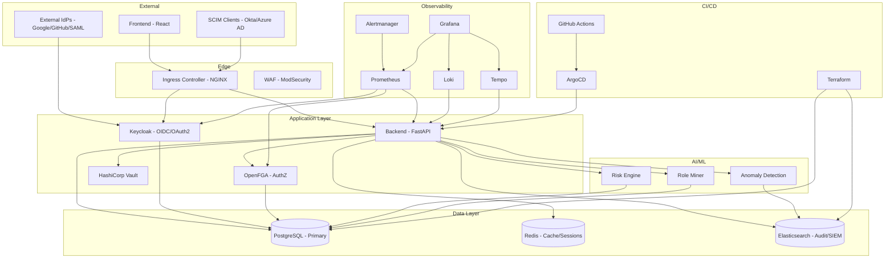
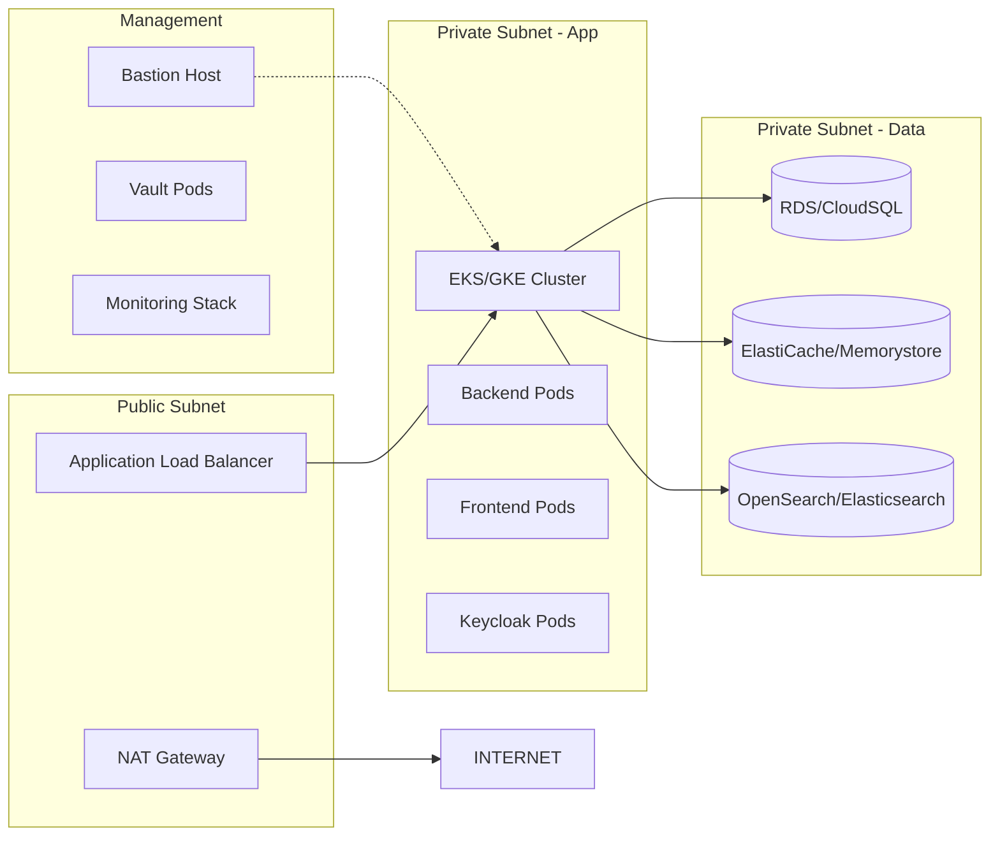
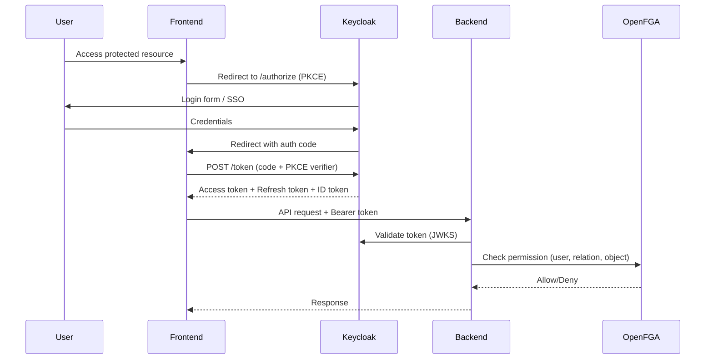
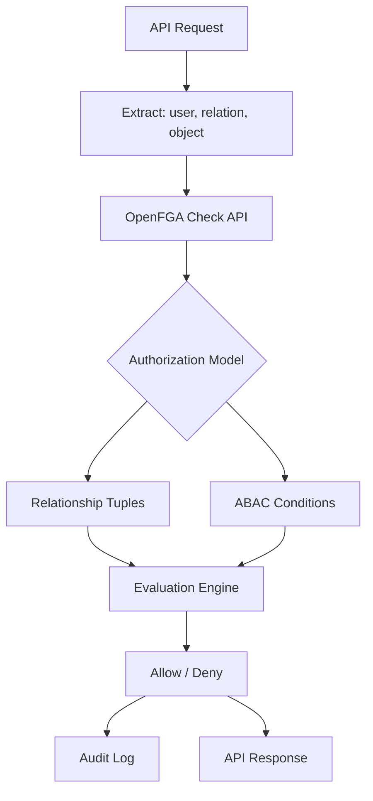
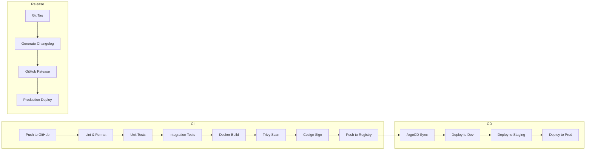
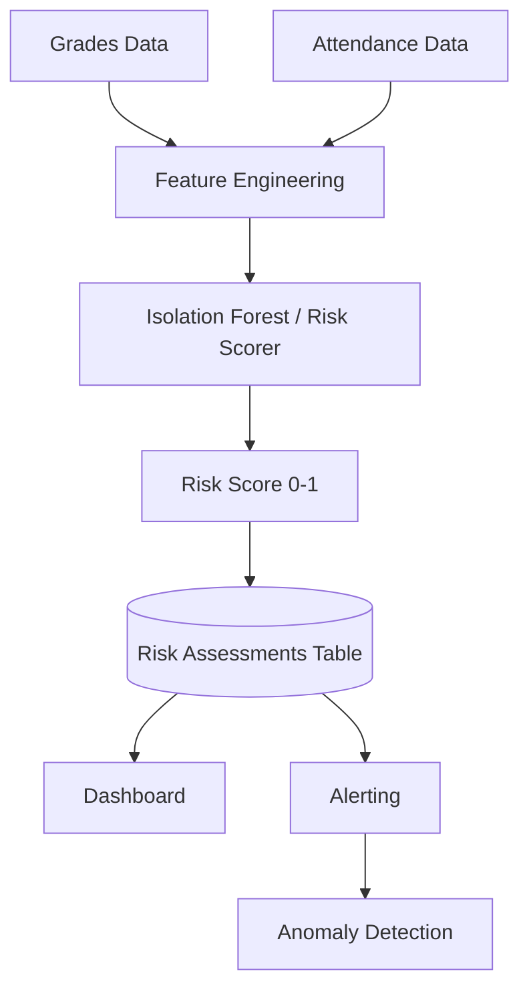
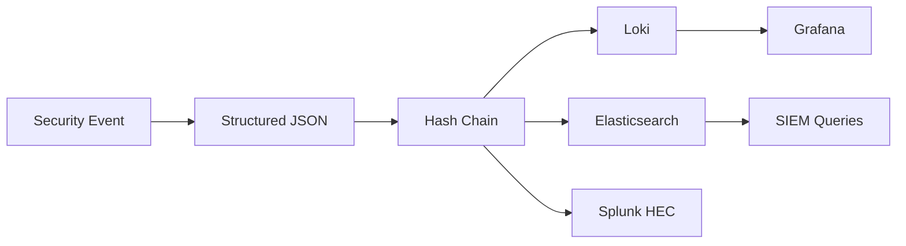

# ARCHITECTURE.md

This document describes the overall architecture of the InsightFlow Edu Enterprise IAM & Analytics Platform.

---

## System Overview



---

## Component Architecture

### Frontend (React + TypeScript)
- **Framework**: React 18, Vite, TypeScript
- **State Management**: TanStack Query (React Query)
- **Routing**: React Router v6
- **Charts**: Recharts
- **Styling**: Tailwind CSS
- **Build**: Vite → Nginx static serving

### Backend (FastAPI + Python)
- **Framework**: FastAPI 0.109+, Pydantic v2
- **Database**: SQLAlchemy 2.0 + PostgreSQL 15
- **Auth**: JWT (current) → OIDC/OAuth2 (Keycloak)
- **AuthZ**: RBAC → FGA (OpenFGA)
- **ML**: scikit-learn, joblib for model persistence
- **Observability**: prometheus-fastapi-instrumentator, OpenTelemetry
- **Testing**: pytest, pytest-asyncio, httpx

### Database (PostgreSQL 15)
- **Primary Tables**: users, classes, enrollments, grades, attendance, risk_assessments
- **IAM Tables**: scim_users, scim_groups, fga_tuples, audit_logs, certifications
- **Extensions**: pgcrypto, uuid-ossp, pg_trgm
- **Connection Pooling**: PgBouncer (production)

### Cache (Redis 7)
- **Use Cases**: Session storage, rate limiting, FGA tuple caching, ML feature store
- **Cluster Mode**: Sentinel for HA (production)

### Identity Provider (Keycloak 24+)
- **Realm**: insightflow
- **Protocols**: OIDC, OAuth2, SAML 2.0
- **Features**: PKCE, refresh token rotation, federation, custom themes
- **Storage**: PostgreSQL (shared or dedicated)

### Authorization (OpenFGA)
- **Model**: Relationship-based (ReBAC) with ABAC conditions
- **Tuples**: Stored in PostgreSQL (OpenFGA's datastore)
- **API**: gRPC + HTTP
- **Cache**: In-memory + Redis for distributed deployments

### Secrets (HashiCorp Vault)
- **Backend**: Integrated storage (Raft) or Consul
- **Seal**: Auto-unseal via AWS KMS / GCP KMS
- **Auth**: Kubernetes auth method
- **Rotation**: Database credentials, API keys, TLS certificates

### Observability Stack
| Component | Purpose | Retention |
|-----------|---------|-----------|
| Prometheus | Metrics collection | 15d (local), 1y (Thanos) |
| Grafana | Visualization | N/A |
| Loki | Log aggregation | 30d |
| Tempo | Distributed tracing | 7d |
| Alertmanager | Alert routing | N/A |

---

## Networking Architecture



### Network Policies
- **Default Deny**: All ingress/egress denied by default
- **App → DB**: Only backend pods can reach PostgreSQL
- **App → Redis**: Only backend/frontend pods
- **App → External**: Only via NAT Gateway (egress)
- **Monitoring → App**: Prometheus, Grafana, Loki, Tempo can scrape
- **Ingress → App**: Only ALB/Ingress controller

---

## Authentication Flow



### Token Lifecycle
| Token Type | Lifetime | Storage | Rotation |
|------------|----------|---------|----------|
| Access Token | 15 min | Memory (JS) | No |
| Refresh Token | 30 days | HttpOnly Cookie | Yes (rotation) |
| ID Token | 15 min | Memory | No |

---

## Authorization Flow (FGA)



### Authorization Model (Simplified)
```fga
model
  schema 1.1

type user
type role
  relations
    define member: [user, user:*]
type organization
  relations
    define owner: [user]
    define admin: [user]
    define member: [user, role:member]
type resource
  relations
    define viewer: [user, role:member]
    define editor: [user, role:member]
    define admin: [user, role:member]
    define owner: [user]
    define parent: [organization]
```

---

## CI/CD Pipeline



### Pipeline Stages
| Stage | Tools | Gates |
|-------|-------|-------|
| Lint/Format | ruff, black, eslint, prettier | Must pass |
| Unit Test | pytest, vitest | >80% coverage |
| Integration Test | pytest + testcontainers | Must pass |
| Build | Docker, BuildKit | Multi-arch (amd64/arm64) |
| Security Scan | Trivy, Grype | No HIGH/CRITICAL |
| Sign | Cosign, Sigstore | Keyless signing |
| Deploy | ArgoCD, Helm, Kustomize | Manual approval for prod |

---

## Data Flow

### Risk Assessment Pipeline


### Audit Log Pipeline


---

## Deployment Architecture

### Environments
| Environment | Purpose | Cluster | Domain |
|-------------|---------|---------|--------|
| Development | Feature testing | kind (local) / EKS dev | dev.insightflow.edu |
| Staging | Integration testing | EKS/GKE staging | staging.insightflow.edu |
| Production | Live traffic | EKS/GKE prod (multi-AZ) | insightflow.edu |

### Release Strategy
- **Development**: Continuous deployment on merge to main
- **Staging**: Daily deployment or on-demand
- **Production**: Git tag triggered, manual approval, blue-green

---

## Security Architecture

### Defense in Depth
1. **Network**: VPC, subnets, security groups, NACLs, WAF
2. **Transport**: TLS 1.3 everywhere (internal mTLS via Istio/Linkerd)
3. **Application**: Input validation, output encoding, CSP, HSTS
4. **Identity**: OIDC/OAuth2, MFA, PKCE, short-lived tokens
5. **Authorization**: FGA, least privilege, regular certification
6. **Data**: Encryption at rest (AES-256), in transit (TLS), field-level for PII
7. **Secrets**: Vault, rotation, no secrets in Git
8. **Supply Chain**: SLSA Level 2, signed images, SBOM
9. **Observability**: Audit logs, anomaly detection, alerting
10. **Incident Response**: Runbooks, playbooks, automated containment

### Threat Model (STRIDE)
| Threat | Mitigation |
|--------|------------|
| Spoofing | OIDC/OAuth2, MFA, certificate pinning |
| Tampering | Immutable audit logs, hash chains, signed images |
| Repudiation | Correlation IDs, tamper-evident logs |
| Information Disclosure | Encryption, least privilege, field-level encryption |
| Denial of Service | Rate limiting, WAF, autoscaling, circuit breakers |
| Elevation of Privilege | FGA, regular certification, anomaly detection |

---

## Scaling Strategy

### Horizontal Pod Autoscaler (HPA)
```yaml
# Backend HPA
metrics:
  - type: Resource
    resource:
      name: cpu
      target:
        type: Utilization
        averageUtilization: 70
  - type: Pods
    pods:
      metric:
        name: http_requests_per_second
      target:
        type: AverageValue
        averageValue: "1000"
```

### Vertical Pod Autoscaler (VPA)
- **Mode**: Auto for dev/staging, Initial for production
- **Resources**: CPU/Memory recommendations based on usage

### Cluster Autoscaler
- **Node Groups**: Separate for system, backend, frontend, monitoring
- **Scale-down**: 10min delay, respect PDBs

### Database Scaling
- **Read Replicas**: 2 for staging, 3 for production
- **Connection Pooling**: PgBouncer (1000 max connections)
- **Partitioning**: Audit logs by month (pg_partman)

---

## Disaster Recovery

### RPO/RTO Targets
| Tier | RPO | RTO |
|------|-----|-----|
| Database (Primary) | < 1 min | < 15 min |
| Database (Audit) | < 5 min | < 1 hour |
| Application | 0 | < 5 min |
| Secrets | 0 | < 5 min |

### Backup Strategy
- **PostgreSQL**: Continuous archiving (WAL-G), daily base backups, point-in-time recovery
- **Redis**: RDB snapshots every 5 min, AOF every second
- **Vault**: Integrated storage snapshots, unseal keys in KMS
- **ETCD**: Velero backups daily
- **Object Storage**: Cross-region replication

---

## Cost Optimization

### Right-sizing
- **VPA recommendations** applied weekly
- **Spot instances** for batch workloads (model training, role mining)
- **Graviton/ARM** for compatible workloads (20-40% savings)

### Storage Tiering
- **Hot**: Loki/Elasticsearch recent data (SSD)
- **Warm**: Compressed, older logs (HDD)
- **Cold**: S3 Glacier / GCS Coldline for audit archives

### Monitoring Costs
- **Prometheus**: Remote write to Thanos/Grafana Cloud for long-term
- **Tempo**: Sampling (10% traces), block storage
- **Loki**: Boltdb-shipper with S3/GCS

---

## Future Extensibility

### Plugin Architecture
- **SCIM Extensions**: Custom schemas for Saviynt-specific attributes
- **FGA Models**: Versioned, hot-reloadable
- **ML Models**: MLflow registry, A/B testing framework
- **Integrations**: Webhook system for third-party SIEM/SOAR

### Multi-tenancy Roadmap
- **Namespace isolation**: Kubernetes namespaces per tenant
- **Data isolation**: Row-level security in PostgreSQL
- **Control plane**: Tenant-aware Keycloak realms, Vault namespaces