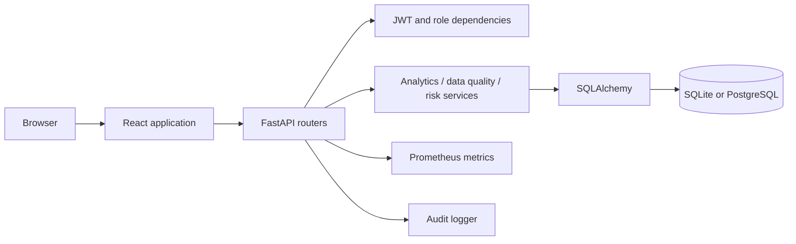

# Architecture

The frontend starts at `frontend/src/main.tsx` and renders `frontend/src/App.tsx`. It calls the FastAPI API through `frontend/src/api/client.ts`.

FastAPI starts in `backend/app/main.py`. Its routers handle authentication, classes, grades, attendance, risk, analytics, and data-quality requests. Analytics, data-quality, and risk services use SQLAlchemy models and database sessions. The application also exposes Prometheus metrics and emits audit events.

